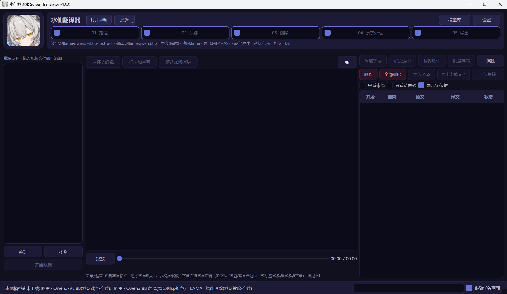

<div align="center">

# 水仙翻译器 SUISEN Translator

**硬字幕视频一站式译制：OCR 定位 → AI 读字翻译 → 无痕擦除原字 → FFmpeg 导出**

[](LICENSE)




</div>

## 📖 目录

- [这是什么](#-这是什么)
- [功能亮点](#-功能亮点)
- [系统要求](#-系统要求)
- [快速开始](#-快速开始)
- [流水线说明](#-流水线说明)
- [本地模型](#-本地模型)
- [无痕擦除引擎](#-无痕擦除引擎)
- [常见问题](#-常见问题)
- [开发者](#-开发者)
- [反馈与贡献](#-反馈与贡献)
- [许可证](#-许可证)
- [致谢](#-致谢)

## 🎬 这是什么

给"内嵌硬字幕"的视频做翻译的桌面工具：字幕不是独立文件、而是烧在画面里的那种。传统做法要手动打轴、抄写、修图，水仙翻译器把整条链路自动化：

**RapidOCR(ONNX) 本地定位字幕区域 → Qwen3-VL / GLM-OCR / 云端 VLM 读字 → 上下文 AI 翻译 → 所见即所得编辑校对 → 原字幕处理（AI 无痕擦除 / 遮罩覆盖 / 保留）→ FFmpeg 合成导出。**

支持批量队列（断点接续、暂停、总进度与剩余时间）、增量重擦、字幕文件导出（ASS/SRT，设置中选）与双语字幕。

<!-- TODO: 截图 —— 建议放 2~3 张: 翻译编辑表格 / 导出前后画面对比 -->

## ✨ 功能亮点

- **断点接续**：取消/失败/重启后再点开始，已识别的跳过识别、已翻译的跳过翻译、已擦除的直接导出
- **队列运行中可编辑其他视频**：队列轮到某个视频时才读取它的最新状态，不会用旧快照覆盖你的改动
- **复核机制**：状态列标出读字把握低/翻译异常/待识别的条目，一键只看待复核；悬停原文可看到该字幕框的原画面截图；被剔除的候选以红框标出原因
- **所见即所得**：预览、成品 MP4、ASS 字幕三者共用同一套排布（有效字号、长句自动折行、拉伸、竖排多列、遮罩四点框）
- **定位框随时可改**：候选段与字幕框都能拖边/角改大小、拖标签移动；改动后擦除缓存自动失效，只重擦有改动的时间段
- **翻译结束自动补译一次漏译条目**

## 💻 系统要求

| 项目 | 要求 |
|---|---|
| 系统 | Windows 10 / 11（64 位） |
| 运行方式 | 普通用户下载 Release 打包版；开发者 Python 3.10 / 3.11 |
| 存储 | 程序本体约 500MB；模型按需下载 1.6GB ~ 18GB（见下表，下载前显示总体积） |
| 硬件 | 纯云端 API 方案：普通办公机即可；本地模型按档位：低配约 8GB 内存，中高配建议 16GB 内存或有 NVIDIA 显卡 |
| 网络 | 首次运行需联网下载模型；FFmpeg 约 110MB 在首次导出时按需下载 |

硬件分级（低/中/高）在首次启动时后台自动探测并套用，`设置 → 杂项` 可重新检测或手动指定。

## 🚀 快速开始

### 普通用户（打包版）

1. 从 [Releases](../../releases) 下载压缩包，解压到**非 Program Files** 的目录（程序要在自身目录写配置和缓存）
2. 运行 `suisen.exe`，首次运行向导会引导选场景、选本地模型或填 API Key
3. 本地模型由模型库排队下载（带进度、可取消），FFmpeg 在首次导出时自动下载

### 开发者（源码运行）

1. Python 3.10/3.11 建虚拟环境：`pip install -r requirements.txt`
   - 若环境中装过 paddle 系列包，建议先卸载避免 DLL 冲突：
     `pip uninstall -y paddlepaddle paddlepaddle-gpu paddleocr paddlex`
2. FFmpeg 不用手动装：首次「原字处理/导出」时自动下载到 `models/bin/ffmpeg.exe`（约 110MB，断点续传）
   - 已有 FFmpeg 会优先使用：[设置→杂项] 指定的路径 → `models/bin/` → 程序目录 → PATH
3. `python main.py` → 首次运行向导选场景、选本地模型或填 API Key

## 🔧 流水线说明

顶部 01~05 五个步骤：

| 步骤 | 性质 | 说明 |
|---|---|---|
| 01 定位 / 02 识别 / 03 翻译 | 工作区 | 不生成任何文件；结果（含定位候选与快照）记录在 `.work/state/`，重启后仍可续跑 |
| 04 原字处理 | 工作区 | 处理方式在[设置→原字处理]三选一：**无痕擦除**——AI 抹掉原字，中间视频缓存到 `.work/erased/`（按字幕+参数+视频文件签名命名；字幕改动后**只重擦有改动的时间段**）；**遮罩覆盖**——导出时按样式盖住原字；**保留原字幕**——译文放下方。不勾选=保留原字幕 |
| 05 导出 | 产出文件 | 唯一会写文件的步骤。优先复用工作区里的擦除画面，没有则现场擦除；可同时生成字幕文件（格式在设置中选，预览区按所选格式所见即所得）。设置里可开启「直接导出」（擦除+嵌字一次编码，不写缓存） |

- 可分批跑：先只勾 01~03 → 再只勾 04 → 最后只勾 05。队列条目右键[重置状态]从头重来
- 画面上拖出的遮挡块：无论哪种处理方式，永远按[遮罩样式]叠加，不参与擦除

## 🤖 本地模型

模型库一键安装，体积按 Ollama 库核实：

| 用途 | 默认 | 低配 | 高配 |
|---|---|---|---|
| 读字 | Qwen3-VL 8B（6.1GB） | GLM-OCR Q8（1.6GB，只能读字不能判别） | Qwen3.8 27B（18GB） |
| 翻译 | Qwen3 8B（5.2GB） | Qwen3 4B（2.6GB） | DeepSeek-R1 8B 备选 |
| 擦除 | LAMA：权重 200MB + 独立运行时；**有 NVIDIA 显卡装 CUDA 版 torch（约 2.6GB），否则 CPU 版（约 200MB）** | OpenCV（无依赖） | — |

## 🧽 无痕擦除引擎

| 引擎 | 部署 | 说明 |
|---|---|---|
| LAMA | 模型库一键安装 | 逐帧，静态背景效果好，默认；无进程内依赖时走常驻子进程小批处理；单帧失效自动回退 OpenCV |
| OpenCV | 无依赖 | Telea 修复，链路验证/低配 |
| STTN / ProPainter / DiffuEraser | 高级：自备 repo 与权重（`third_party/` 或 `models/inpaint/`） | 视频级修复；**ProPainter 为非商用许可** |
| HTTP API | `iopaint start --model=lama --port=8080`，填 `/api/v1/inpaint` | 远程/自建 |

- 命令模板可在 config.json `erase_cmd` 覆盖，占位符：`{python} {repo} {video} {maskvideo} {framesdir} {maskdir} {outdir}`
- 调试模式下每次擦除在 `logs/render-*/` 留下 before/after/mask 图与 report.json；非调试模式不留任何文件

## ❓ 常见问题

**Q: 首次运行要下载多少东西？**
取决于你选的方案：RapidOCR 检测模型约 80MB（必下）+ 本地模型按组合 1.6GB ~ 18GB（可选，用云端 API 则不下载）。模型库下载前会显示总体积，可取消。

**Q: FFmpeg 要我自己装吗？**
不用。首次走到「原字处理/导出」时程序自动下载（约 110MB，断点续传）。FFmpeg 是 GPL 组件，所以不随包分发、在你的机器上按需下载。

**Q: 我的 API Key 存在哪？**
存入系统凭据库（Windows 凭据管理器 / macOS 钥匙串 / Linux SecretService），不写明文文件。

**Q: 杀毒软件报毒？**
PyInstaller 打包的软件被误报较常见；源码运行则无此问题。HTTPS 下载被代理/杀软拦截时程序会自动信任 Windows 系统证书库。

**Q: 中途关了/失败了怎么办？**
直接重新点开始队列。所有中间状态都在 `.work/state/`，已完成的步骤自动跳过。

**Q: 支持竖排字幕吗？**
支持，竖排多列、长句自动折行、拉伸都在同一套排布引擎里，预览即所得。

## 🛠 开发者

```bash
# 运行测试（需先装依赖）
python -m unittest discover -s tests

# 打包成 exe（PyInstaller onedir），详见 PACKAGING.md
pyinstaller suisen.spec
```

打包要点、FFmpeg/许可证合规细节、发布前检查清单见 [PACKAGING.md](PACKAGING.md)。

## 🤝 反馈与贡献

- 遇到问题或有功能建议：欢迎开 [Issue](../../issues)，附上 `logs/` 里的日志能大幅加快定位
- 欢迎 Pull Request：建议先在 Issue 里讨论方向，大改动请附测试

## 📄 许可证

本项目以 [Apache License 2.0](LICENSE) 开源。

注意：FFmpeg 与 libmpv 为 GPL/LGPL 组件，**不包含**在本仓库与发行包中，由程序在你的机器上按需下载；ProPainter 为非商用许可，需用户自行获取。详见 PACKAGING.md 的许可证速查表。

## 🙏 致谢

站在这些优秀项目的肩膀上：[RapidOCR](https://github.com/RapidAI/RapidOCR) · [FFmpeg](https://ffmpeg.org/) · [LaMa](https://github.com/advimman/lama) / [simple-lama-inpainting](https://github.com/enesmsahin/simple-lama-inpainting) · [mpv](https://mpv.io/) · [OpenCV](https://opencv.org/) · [Ollama](https://ollama.com/) 及 Qwen / GLM / DeepSeek 等开源模型。
